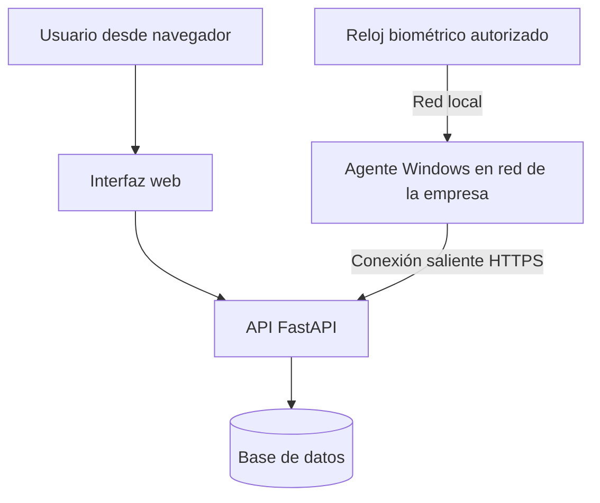

# ⏱️ X-Time
### Gestión de asistencia, presentismo y control biométrico para empresas

**Portfolio público del proyecto · El código fuente se mantiene privado**

---

## Sobre X-Time

**X-Time** es un proyecto de plataforma web orientada a centralizar la gestión de asistencia, horarios, empleados y presentismo en empresas con una o varias sucursales.

Combina una aplicación web con un **agente local de integración biométrica**, pensado para comunicar dispositivos de control de asistencia en la red interna de la empresa con los servicios centrales, sin exponer directamente el reloj a Internet.

> **Estado del proyecto:** desarrollo funcional y validaciones de piloto. Se están contemplando pruebas con hardware, seguridad, respaldos y operación antes de un despliegue comercial en producción.

## Funcionalidades del proyecto

| Área | Descripción |
|:---|:---|
| 🕒 Asistencia y horarios | Registro de marcaciones, horarios y reglas de presentismo configurables |
| 🏢 Multiempresa y sucursales | Gestión separada por empresa, con alcance operativo por sucursal |
| 👥 Usuarios y permisos | Roles diferenciados para propietarios, administradores, encargados y empleados |
| 🔐 Seguridad | Autenticación, controles de autorización en backend y trazabilidad de operaciones |
| 📟 Integración biométrica | Agente Windows para integrar relojes ANVIZ en redes autorizadas |
| 📊 Gestión y reportes | Panel de operación y reportes de asistencia |
| 🙋 Autogestión | Consulta de calendario, asistencias y marcaciones propias en una primera fase |

## Tecnologías

| Capa | Tecnologías |
|:---|:---|
| Interfaz web | **React · TypeScript · Vite** |
| API y lógica de negocio | **Python · FastAPI** |
| Persistencia | **SQLAlchemy · Alembic** |
| Base de datos | **PostgreSQL** (arquitectura de producción prevista); SQLite en etapas de desarrollo |
| Integración local | **Windows · Python x86 · SDK ANVIZ** |
| Despliegue | **Docker** y arquitectura SaaS cliente-servidor |

## Arquitectura general

El agente opera en la infraestructura del cliente, mientras que la interfaz, la API y la persistencia forman parte de la plataforma central. El modelo contempla aislamiento de datos por empresa y permisos por rol.

## Qué demuestra este proyecto

- Diseño y desarrollo de una solución **full stack** con componentes web, API y persistencia.
- Modelado de un producto **multiempresa**, con autenticación y autorización.
- Integración de software con **hardware biométrico** mediante un agente local.
- Aplicación de principios de **trazabilidad, separación de responsabilidades y seguridad**.
- Planificación de validaciones, pruebas y requisitos para despliegue.

## Capturas y demostración

Las capturas del sistema y el material de demostración se incorporarán aquí una vez revisados para evitar publicar datos de empleados, empresas, credenciales o infraestructura real.

## Sobre el código fuente

Este repositorio presenta el proyecto con fines de **portfolio profesional**. No incluye el código propietario, los secretos de configuración, las bases de datos ni los componentes internos del producto.

La documentación describe el alcance técnico del proyecto y no constituye una oferta de uso, licencia de distribución ni garantía de disponibilidad comercial.

---

**X-Time · Diseño y desarrollo de software · 2026**

